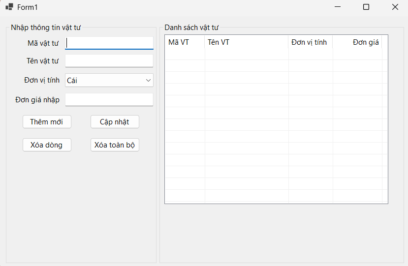
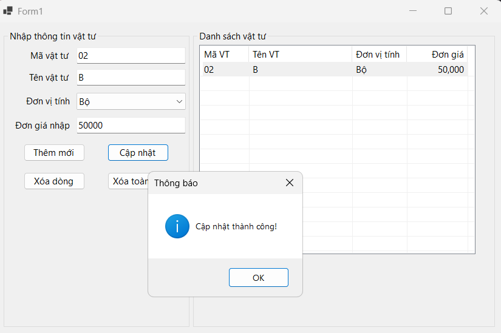

## THÔNG TIN SINH VIÊN 
- **Họ và tên:** Phạm Huy Hoàng
- **Mã số sinh viên:** 24810340415 
- **Lớp:** D19CNPM3 
- **Tên môn học:** Lập trình C# / Windows Forms 
- **Tên bài tập:** Bài 2: Form Tiếp nhận & Phân loại sự cố IT (IT Support Ticket Form) 
--- 
## KẾT QUẢ THỰC HÀNH 
### 1. Ảnh màn hình Giao diện chính 
 
### 2. Ảnh màn hình Chức năng thực thi / Kết quả 
 
 
.png) 
.png) 
.png) 
.png) 
### 3. Ảnh màn hình Kiểm tra lỗi (Validation)
.png)
.png)
.png)

